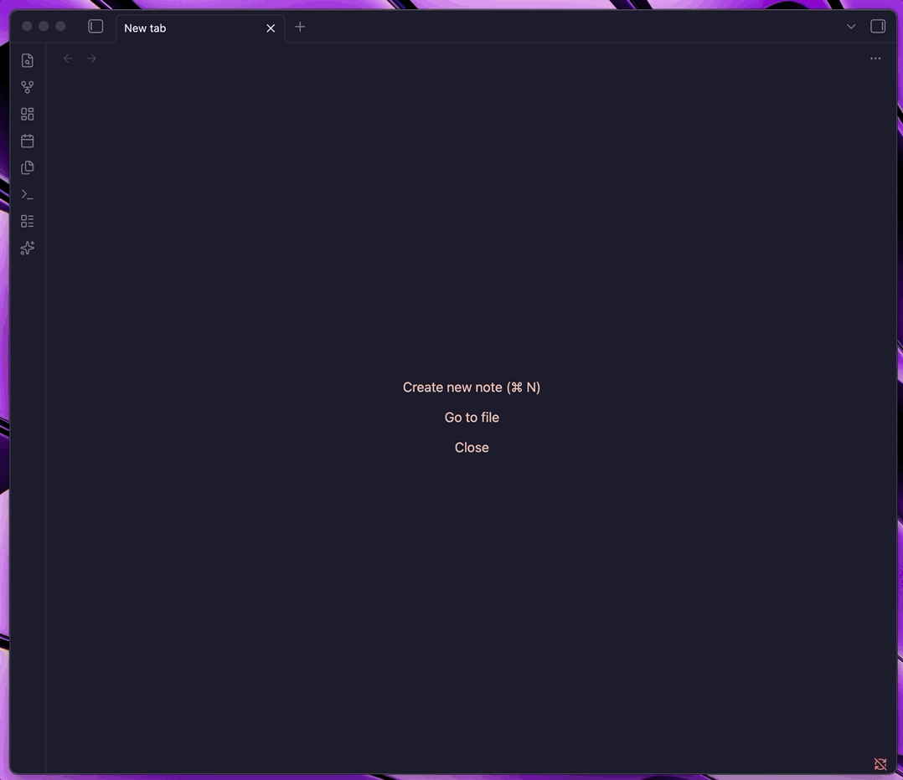
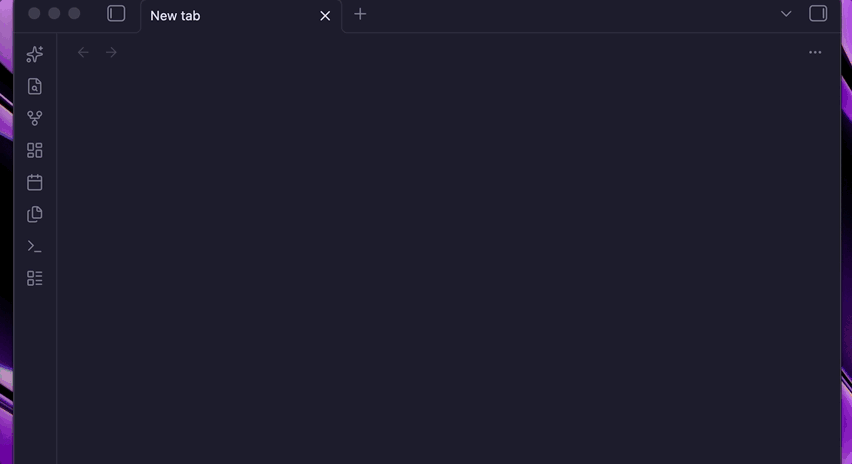
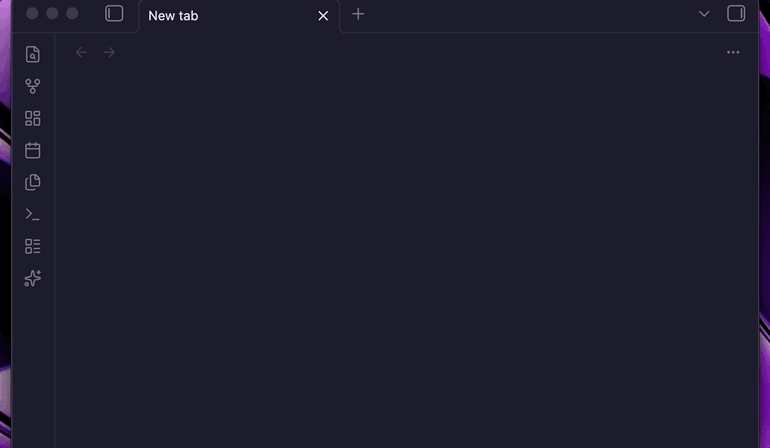
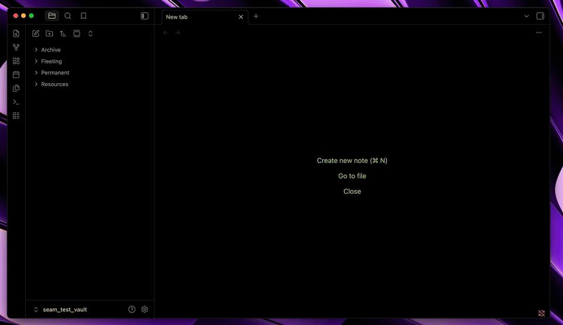
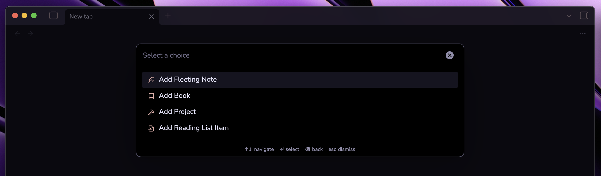
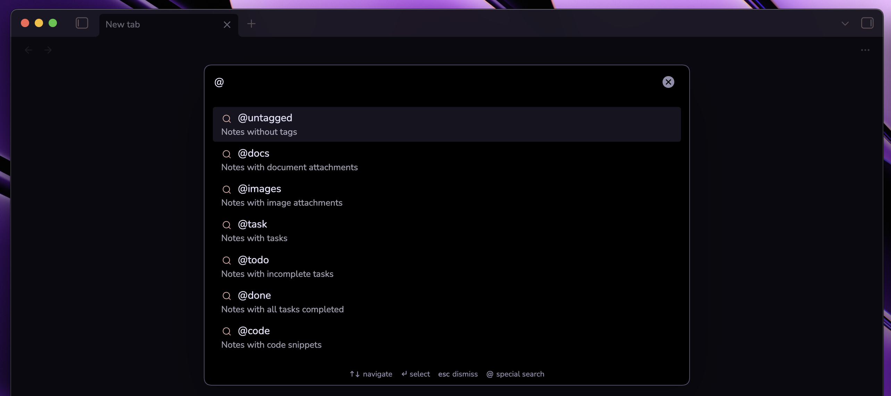
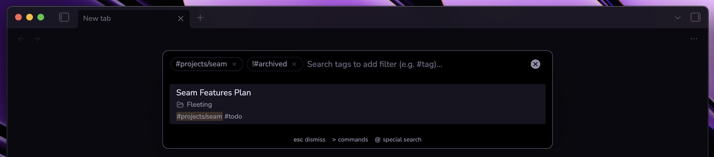
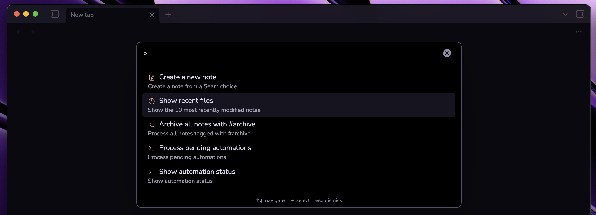

# Changelog

What's new and changed in each Seam release.

## [Unreleased] - 2026-10-27
<!-- iterations: iteration_13..iteration_15 -->

### Added
- **Palette note pins**: Pin or unpin the current Markdown note and keep it first in the empty-input Universal Palette, even with default commands hidden. Persist references across reloads, follow file/folder moves, and remove deleted references. Palette note pins are independent of calendar pins and special-query pins.
- **Note completion**: Offer “Show current note's percentage completion” only for notes containing tasks. Display a theme-colored progress bar and counts of unfinished, partially done (`[/]`), completed, and total items inside the Palette. Include unsaved editor content and respect reduced motion. Press Backspace from completion or Note statistics to return to Palette search, with a matching footer hint.
- **Periodic-note confirmation**: Ask before Seam creates a daily, weekly, or yearly note, including calendar actions, rolling weekly pins, date queries, and daily-task transfer. Show the target path and allow cancellation without creation. Add a default-on Calendar and periodic notes setting; existing notes open directly.
- **Palette group names**: Separate related commands with dimmed names such as Note Statistics and Move Notes, and distinguish built-in/custom special queries without adding selectable rows. Add a default-on Interface toggle.
- **Palette descriptions**: Control command and special-query descriptions from Universal Palette settings, and add an optional description to each custom search query.
- **Global Statistics**: Open a writing dashboard inside the Universal Palette through “Show global statistics,” grouped with note reports. Show current Markdown note/word totals, recorded active days, and a current writing streak. Use four overview cards in a row or a responsive 2×2 layout.
- **Writing activity**: Explore 52 weekly columns or three months of daily contributions, with month/weekday labels and five themed intensity levels. Switch between gross words written, distinct notes edited, and writing sessions. Hover for details or select a day to see its notes and word contributions; open a note directly. Include mouse, keyboard, and touch support, horizontal heatmap scrolling, English/PT-BR text, and meaningful empty/untracked states.
- **Writing over time**: Show six vertical monthly bars with a shared linear scale, axis ticks/grid lines, month labels and values, including the current month, for recorded words written or observed Markdown note creations. Do not invent history for existing notes.
- **Local activity history**: Persist counts, timestamps, and stable note references in `statistics.json`, with a small local write-ahead journal for recovery. Track local dates at edit time, preserve dates through timezone changes, follow file/folder renames, and retain historical contributions when a note is deleted.
- **Initialize Seam**: Preview an optional vault setup from Seam Settings, the Obsidian command palette, or the Universal Palette. Review grouped folders/files, Obsidian preferences, and Seam searches before confirming. Create only missing workflow directories and templates, configure selected preferences with new notes directed to `Fleeting`, and report applied, skipped, failed, and restart-required items. Existing notes are never scanned, moved, deleted, or edited by setup.
- **Bookshelf setup**: Create a native four-view Bookshelf Base and reusable `@bookshelf` / `@reading` queries. Include book properties, priority icons/order, zero-safe ratings, estimated reading hours, bounded progress bars, and unread/missing-value handling. Exclude the templates folder from every view and preserve customized files and alias collisions.

### Changed
- **Calendar pin feedback**: Highlight calendar pinned-note buttons with the theme hover background on hover and visible keyboard focus.
- **Query-pin count**: Show `Pinned • N/5` aligned to the right of the Search Queries title, with the subtitle beneath, counting all built-in/custom pins independently of the settings filter.
- **Completion consistency**: Partially done tasks no longer count as fully completed in the existing `@todo` result percentage. Keep special-query pin priority and configured ordering when showing group labels.
- **Dashboard controls**: Replace dropdowns with themed pill chips. Keep Year / 3 months at the dashboard’s top right, Words / Notes / Activity beside the activity heading, and Words / Notes above the monthly chart. Support roving radio-group keyboard focus and touch.
- **Background totals**: Index current notes after layout readiness with bounded concurrent reads. Maintain totals from subsequent file/editor events rather than rescanning when a dashboard opens. Include current unsaved editor text and keep imports/sync/automated updates separate from writing activity.
- **Activity definitions**: Count direct editor transactions with user input, deletion, or movement origins. Preserve word credit while typing/composing, count new replacement words, and exclude undo/redo from new contributions. Group sessions per note/day with a five-minute inactivity gap. A streak may end yesterday while today is still in progress. Notes Created records actual post-enable Markdown create events as vault growth, including imports, without treating creation alone as writing activity.
- **Report navigation**: Reuse Palette report framing, dismissal, and Backspace navigation. Chip radio groups and date-cell keys avoid the hidden suggestion chooser. Dispose dashboard subscriptions/timers when returning, dismissing, or unloading.
- **Calendar opening shortcuts**: Open daily, weekly, and pinned notes from `@calendar` with Mod+Enter in a new tab or Shift+Enter in a vertical split. Keep the requested destination through creation confirmation and show contextual open/create shortcut hints. Escape returns from calendar navigation to search before dismissing the Palette.
- **Bases keyboard navigation**: Enter result navigation with Up/Down from search. Navigate cards with all four arrows, keep the preferred column through incomplete/virtualized rows, and use Left/Right to reveal columns in tables. Escape returns to the editable search input while preserving the query. Retain normal, new-tab, and split opening shortcuts, and show navigation-specific footer hints. Highlight the entire selected card, including its cover, without a border around the result container.
- **Archive destination**: Initialize Seam creates and recommends `Resources/Archive` as the archive destination. Existing root-level archive folders and notes stay in place.
- **Setup completion**: Show “Already configured,” a confirmation message, and OK when the current vault matches the recommendations, including after a verified successful setup. Keep configuration details collapsed on repeat visits and retain restart requirements in the completion report. Missing or drifted settings return to the preview/apply flow; conflicts and unsupported items do not produce a completed state.
- **Setup safeguards**: Keep setup entirely user initiated. Show replacements explicitly, collapse already-configured items on repeat previews, and preserve unrelated configuration, shortcuts, property types, core-plugin states, and custom searches. Save recoverable copies of existing configuration before changes and request an Obsidian restart for configuration-file updates. Skip unsupported settings, invalid JSON, conflicting paths, changed targets, and unavailable dependencies.

### Removed
- **Query-history cycling**: Remove session query storage and Up/Down query recall from the Universal Palette. Arrow keys use normal suggestion/calendar/Base navigation.

### Fixed
- **Partial-task completion percentages**:
  - **Root Cause**: The existing result percentage counted every nonempty checkbox status, including `[/]`, as completed.
  - **Fix**: Share the same task summary for the completion report and result percentages, with partial tasks counted separately.
  - **Verified Scenarios**: Mixed unfinished, partial, and completed tasks; all-partial notes; unsaved editor text; and a live 50% report for two fully completed tasks out of four.
- **Overlapping activity tooltips**:
  - **Root Cause**: Day cells provided the same text as both a native `title` and an Obsidian `aria-label` tooltip.
  - **Fix**: Use Obsidian’s tooltip API and accessible labels without native title attributes, including monthly bars and note details.
  - **Verified Scenarios**: A real pointer hover produced one Obsidian tooltip; no native titles remained in the dashboard.
- **Statistics loading and reload races**:
  - **Root Cause**: An editor can temporarily expose empty content during initial file loading, asynchronous reads can lag unsaved edits, and reloads can overlap unfinished initialization or storage writes.
  - **Fix**: Maintain editor-observed word counts and per-file read versions. Serialize initialization/writes across reloads, validate and replay sequenced recovery events once, and preserve buffered user input until history is available.
  - **Verified Scenarios**: Initial editor loading, stale reads, same-note sessions across reloads, duplicate transaction/recovery events, failed saves/recovery, early input during initialization, and a reload while the previous writer is blocked.

## [3.1.0] - 2026-10-23
<!-- iterations: iteration_11..iteration_12 -->

### Added

- **Current week and year notes**: Use `@thisWeek` and `@thisYear` to open the current note or create it from your template, with the same tab/split shortcuts as `@today`. Configure yearly notes in Seam or reuse Periodic Notes settings.
- **Weekly notes**: Open or create the selected week’s note from the calendar using Periodic Notes settings or Seam’s weekly folder, format, and template. Supports locale and ISO weeks.
- **Calendar pins**: Keep up to three notes visible above the calendar, including an optional rolling current-week note. Pins persist, follow moves/renames, and disappear when their notes are deleted.
- **Daily Notes calendar**: Browse `@calendar` in the Universal Palette, see dates with notes, jump between months/years, and open or create Daily Notes with your configured template. Supports keyboard navigation and keeps `@today`, `@yesterday`, and `@calendar` together.
- **Delete current note**: Delete the open note from Obsidian or Seam commands, respecting Obsidian’s confirmation setting and configured system trash, vault `.trash`, or permanent deletion.
- **Note outline**: Browse all headings in the current note, including nested headings, in the Universal Palette. Use arrow keys to navigate and Enter or a click to jump to a heading. Press Backspace with an empty input to return to Palette search.
- **Note statistics**: Show words, characters, paragraphs, reading time, and modified/created dates for the current note in the Universal Palette, including unsaved editor text.
- **Special searches**: Find your ten most recently opened files with `@recentlyOpened`, or browse the configured folders with `@fleeting` and `@permanent`. Combine them with other Seam filters.
- **Daily task transfer**: Move unfinished tasks to tomorrow's Daily Note or pull them from yesterday. Preserve nested task context and completed work, and create missing notes using your Daily Notes folder, date format, and template.
- **Missing Daily Notes**: Create and open today’s or yesterday’s Daily Note from an empty `@today` or `@yesterday` search, using your configured template.
- **Palette history**: Press Up in an empty input to cycle through previous queries from the current session.

### Changed

- **Special-query pins**: Pin up to five built-in or custom queries in the Universal Palette.
- **Daily Note results**: See readable dates and a calendar subtitle in the Palette.
- **Daily task commands**: Show Move and Pull only when their source Daily Note contains unfinished work.

### Fixed

- **Palette controls**: The close button dismisses the Palette with a click, Enter, or Space. Pinned special queries stay above unpinned queries, including date queries, and refresh immediately after settings changes.
- **Daily Note creation shortcuts**: Create missing `@today` and `@yesterday` notes in a new tab or vertical split using the Palette shortcuts. Shortcut labels say “create” when the note does not exist.

## [3.0.1] - 2026-10-04
<!-- iterations: iteration_08..iteration_10 -->

### Added

- **Special Search and custom queries**: Save and pin searches using the Seam search system or an Obsidian Base. Choose which built-in searches appear and reorder them.
- **Obsidian Bases**: Browse Base views directly in the Universal Palette, including on mobile.
- **Combined search**: Search notes and files by name, path, or extension; combine text, tags, saved searches, and `/` folder filters. Results show matching passages and match counts.

- **Special searches**: Find recent files, notes from a date range, today's or yesterday's Daily Note, and tasks. `@todo` results can show task completion percentages.
- **Quick note command**: Create and open a note instantly using the configured Fleeting folder and template.

- **Source notes**: Automatically create linked notes for supported documents and images in a chosen folder with your template, or create them from an attachment in the Universal Palette. Find them with `@sources`; embedded PDFs display as continuous pages. Existing files are included when source automation is enabled or the folder changes.

### Changed

- Seam now requires Obsidian **1.13.0** or newer.
- Open search results in a vertical split with `Shift + Enter`.

## [3.0.0] - 2026-10-04
<!-- iterations: iteration_08..iteration_10 -->

### Added

- **Special Search and custom queries**: Save and pin searches using the Seam search system or an Obsidian Base. Choose which built-in searches appear and reorder them.
- **Obsidian Bases**: Browse Base views directly in the Universal Palette, including on mobile.
- **Combined search**: Search notes and files by name, path, or extension; combine text, tags, saved searches, and `/` folder filters. Results show matching passages and match counts.

- **Special searches**: Find recent files, notes from a date range, today's or yesterday's Daily Note, and tasks. `@todo` results can show task completion percentages.
- **Quick note command**: Create and open a note instantly using the configured Fleeting folder and template.

- **Source notes**: Automatically create linked notes for supported documents and images in a chosen folder with your template, or create them from an attachment in the Universal Palette. Find them with `@sources`; embedded PDFs display as continuous pages. Existing files are included when source automation is enabled or the folder changes.

### Changed

- Seam now requires Obsidian **1.13.0** or newer.
- Open search results in a vertical split with `Shift + Enter`.

## [2.0.1] - 2026-09-23

### Changed

- Release screenshots now display in Seam's update window.

## [2.0.0] - 2026-09-23
<!-- iterations: iteration_06..iteration_07 -->

### Added

- **Quick Capture**: Create capture shortcuts with your preferred templates and folders.

- **Special searches**: Find documents, images, tasks, code, and untagged notes. Search exact phrases with double quotes.

- **Exclude tags**: Use `!#tag` to leave matching notes out of your search.

- **Recent Files**: Browse your ten most recently modified notes.

- **Release updates**: Choose when to receive update notices and read release notes in settings.

### Changed

- **Universal Palette**: Clearer search hints and command navigation.
- **Quick Capture settings**: Filter, reorder, duplicate, and customize your capture choices.

## [1.0.4] - 2026-09-15

### Changed

- Clearer English and Brazilian Portuguese guides for getting started and using Seam.

## [1.0.3] - 2026-09-14

### Added

- **Automation timing**: Organize notes when switching notes or after a short delay.
- **Shortcut settings**: See your Palette shortcut and customize it through Obsidian's Hotkeys settings.
- **Visual walkthrough**: Preview Seam's organization and search features in the documentation.
- **Project support**: New sponsorship options.

### Changed

- Seam is now licensed under the GNU General Public License v3.0.

## [1.0.2] - 2026-09-13

### Changed

- Choose your Palette shortcut in Obsidian's Hotkeys settings; no shortcut is assigned by default.
- Improved native settings appearance and support for pop-out windows.

## [1.0.1] - 2026-09-13

### Changed

- Updated Seam's plugin listing information.

## [1.0.0] - 2026-09-13
<!-- iterations: iteration_00..iteration_05 -->

Initial public release of **Seam**.

### Added

- **Automatic organization**: Move notes with `#permanent` and `#archive` on desktop and mobile.
- **Move cleanup**: Remove temporary tags and properties as notes are organized.
- **Universal Palette**: Search titles, note content, and tags from one place.
- **Fleeting notes**: Create notes instantly with an optional template.
- **Palette actions**: Open results in new tabs and run Seam commands.
- **Organization commands**: Archive notes, move them to Permanent, and process pending automations.
- **Personalization**: Customize folders, shortcuts, and search icons.
- **Languages**: English and Brazilian Portuguese.
