# Changelog

What's new and changed in each Seam release.

## [Unreleased]

<!-- iterations: iteration_18..iteration_20 -->

### Added

- **Image Layout**: Create and edit Grid, Flex, and Masonry galleries from the Universal Palette, with live previews, image ordering, captions, and crop controls. Configuration stays in Markdown.
- **Monthly writing summary**: See words added this month separately from the current vault word total, with clear explanations of how deletions affect each measure.

### Changed

- Use Cmd+[ on macOS or Ctrl+[ on Windows/Linux to go back from Palette and Utility views, including with text in the input. Backspace remains available for text and selected-token editing.
- **Writing comparisons**: Compare matching days across months and show when history is insufficient for a reliable comparison.

### Fixed

- Prevent recognized text moves within or between notes from inflating recorded words added.

## [4.0.1] - 2026-11-03

### Fixed

- Improved compatibility with Obsidian’s plugin guidelines while preserving writing statistics and recovery data.

### Added

- **Initialize Seam**: Preview and set up recommended folders, templates, settings, and searches for your vault. Existing notes stay untouched, and configuration backups are kept for recovery.

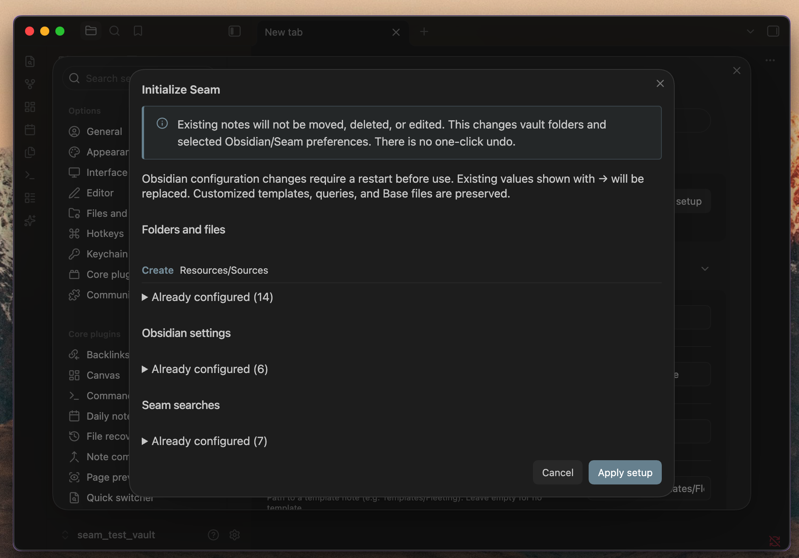

- **Bookshelf**: Set up a four-view reading dashboard in Obsidian Bases, with `@bookshelf` and `@reading` searches.

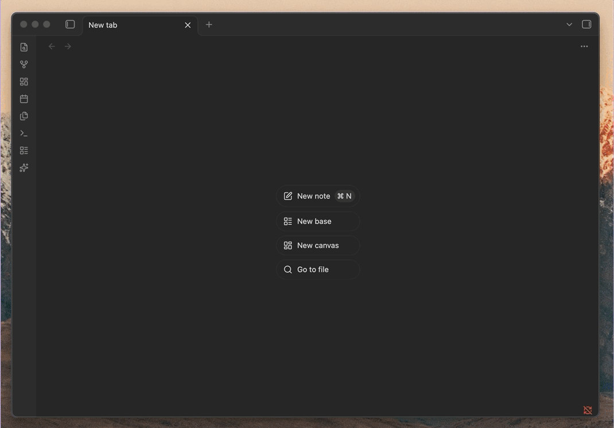

- **Global Statistics**: Explore your note and word totals, writing streaks, activity calendar, and monthly trends. Select a day to see its notes, and sync activity across devices by enabling “Sync all other types” in Obsidian Sync.

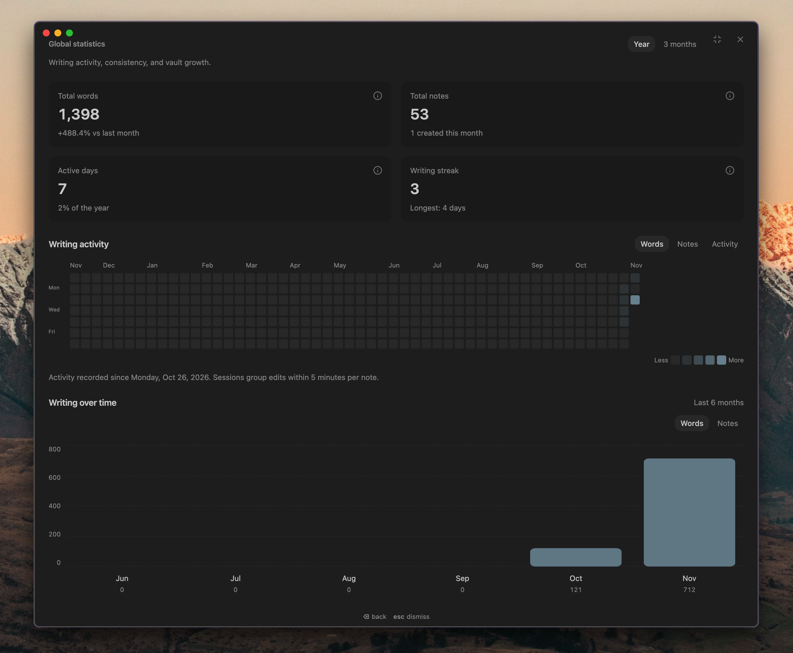

- **Calendar and periodic notes**: Browse Daily Notes with `@calendar`, open or create notes with `@today`, `@yesterday`, `@thisWeek`, and `@thisYear`, and pin up to three notes above the calendar.

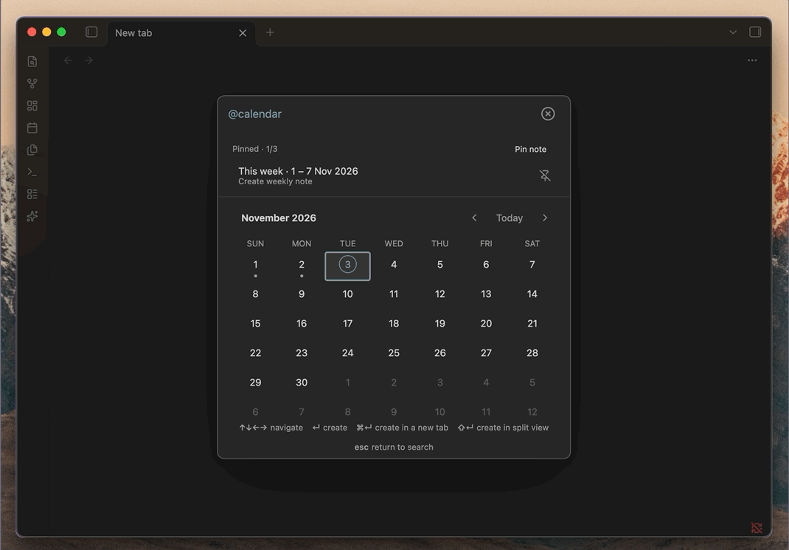

- **Daily task transfer**: Move unfinished tasks to tomorrow's Daily Note or bring yesterday's tasks into today, keeping their nested context.
- **Note reports**: View a note's word count, reading time, task completion, and outline in the Universal Palette. Fold outline headings to focus on a section.
- **Delete current note**: Delete the open note with a command that respects your Obsidian deletion settings.
- **Palette pins and command mode**: Pin notes and up to five commands for quick access. Open the Palette directly in command mode with an assignable shortcut.
- **More special searches**: Find recently opened files and notes in your Fleeting or Permanent folders with `@recentlyOpened`, `@fleeting`, and `@permanent`.
- **Create from saved searches**: Create a note directly from an empty saved search, using its folder and positive tag filters.
- **Settings search**: Find settings by name or description and expand or collapse sections.

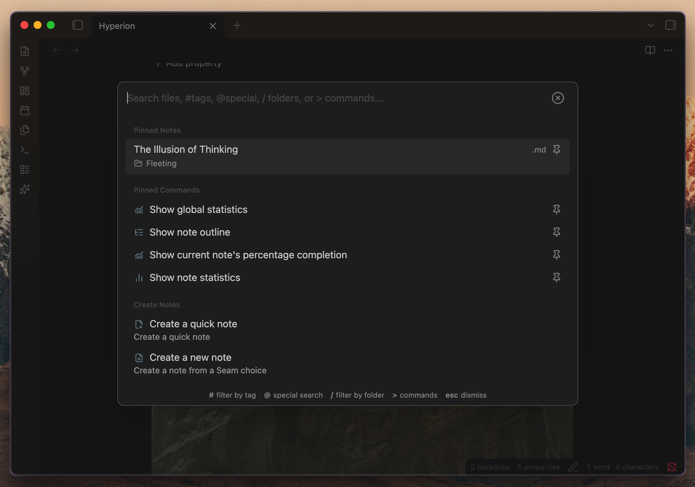

### Changed

- **Palette search**: Optionally show only Markdown files, and choose separately whether to show file extensions and match counts. Title matches are included in the count.
- **Palette and Bases navigation**: Use keyboard shortcuts to open notes in tabs or splits and navigate Base results. Commands and searches can show group names and descriptions.
- **Periodic note creation**: Review a confirmation before creating a missing daily, weekly, or yearly note; you can turn this off in settings.
- **Mobile Palette**: Hide the keyboard with an optional button beside the search field while keeping your search open.
- **Query history**: Up and Down now navigate results instead of cycling through previous searches.

## [4.0.0] - 2026-11-03
<!-- iterations: iteration_11..iteration_17 -->

### Added

- **Initialize Seam**: Preview and set up recommended folders, templates, settings, and searches for your vault. Existing notes stay untouched, and configuration backups are kept for recovery.

- **Bookshelf**: Set up a four-view reading dashboard in Obsidian Bases, with `@bookshelf` and `@reading` searches.

- **Global Statistics**: Explore your note and word totals, writing streaks, activity calendar, and monthly trends. Select a day to see its notes, and sync activity across devices by enabling “Sync all other types” in Obsidian Sync.

- **Calendar and periodic notes**: Browse Daily Notes with `@calendar`, open or create notes with `@today`, `@yesterday`, `@thisWeek`, and `@thisYear`, and pin up to three notes above the calendar.

- **Daily task transfer**: Move unfinished tasks to tomorrow's Daily Note or bring yesterday's tasks into today, keeping their nested context.
- **Note reports**: View a note's word count, reading time, task completion, and outline in the Universal Palette. Fold outline headings to focus on a section.
- **Delete current note**: Delete the open note with a command that respects your Obsidian deletion settings.
- **Palette pins and command mode**: Pin notes and up to five commands for quick access. Open the Palette directly in command mode with an assignable shortcut.
- **More special searches**: Find recently opened files and notes in your Fleeting or Permanent folders with `@recentlyOpened`, `@fleeting`, and `@permanent`.
- **Create from saved searches**: Create a note directly from an empty saved search, using its folder and positive tag filters.
- **Settings search**: Find settings by name or description and expand or collapse sections.

### Changed

- **Palette search**: Optionally show only Markdown files, and choose separately whether to show file extensions and match counts. Title matches are included in the count.
- **Palette and Bases navigation**: Use keyboard shortcuts to open notes in tabs or splits and navigate Base results. Commands and searches can show group names and descriptions.
- **Periodic note creation**: Review a confirmation before creating a missing daily, weekly, or yearly note; you can turn this off in settings.
- **Mobile Palette**: Hide the keyboard with an optional button beside the search field while keeping your search open.
- **Query history**: Up and Down now navigate results instead of cycling through previous searches.

## [3.0.1] - 2026-10-04
<!-- iterations: iteration_08..iteration_10 -->

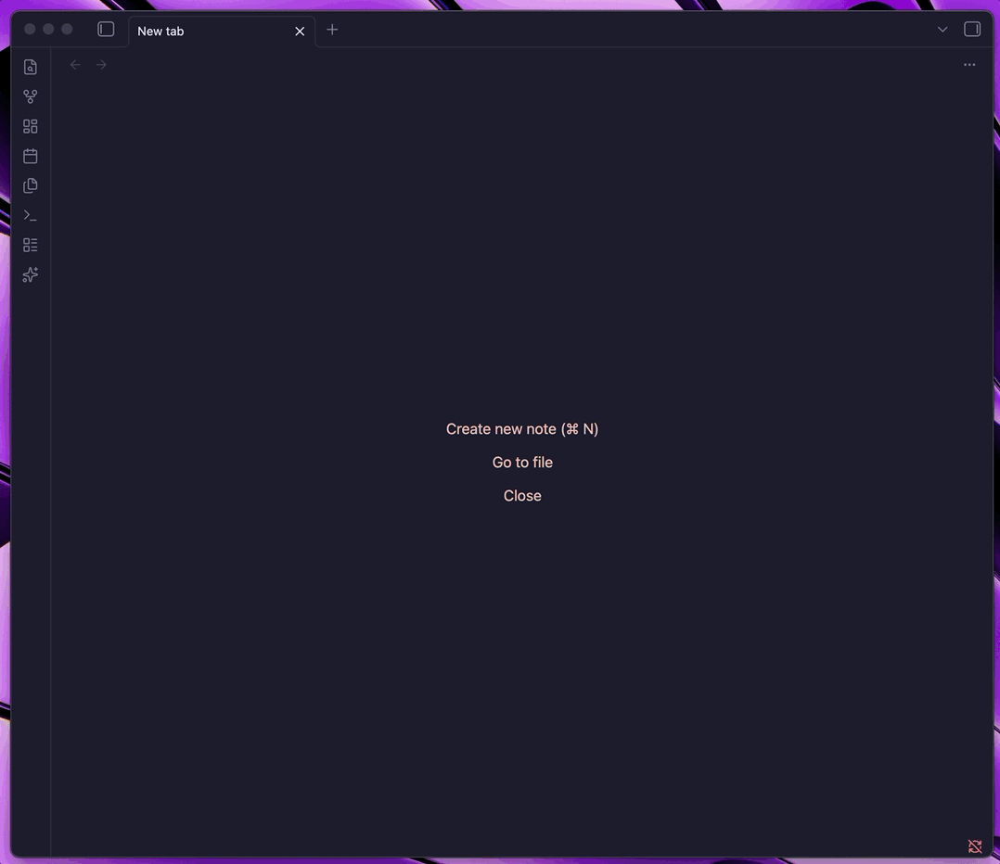

### Added

- **Special Search and custom queries**: Save and pin searches using the Seam search system or an Obsidian Base. Choose which built-in searches appear and reorder them.
- **Obsidian Bases**: Browse Base views directly in the Universal Palette, including on mobile.
- **Combined search**: Search notes and files by name, path, or extension; combine text, tags, saved searches, and `/` folder filters. Results show matching passages and match counts.

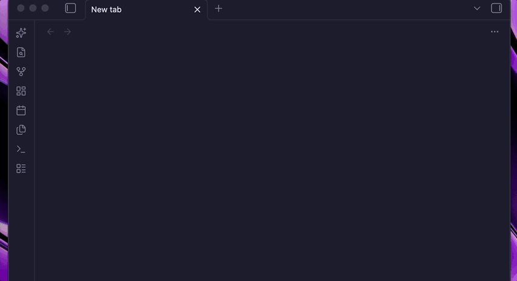

- **Special searches**: Find recent files, notes from a date range, today's or yesterday's Daily Note, and tasks. `@todo` results can show task completion percentages.
- **Quick note command**: Create and open a note instantly using the configured Fleeting folder and template.

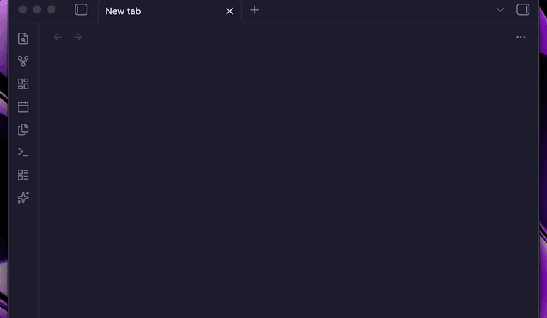

- **Source notes**: Automatically create linked notes for supported documents and images in a chosen folder with your template, or create them from an attachment in the Universal Palette. Find them with `@sources`; embedded PDFs display as continuous pages. Existing files are included when source automation is enabled or the folder changes.

### Changed

- Seam now requires Obsidian **1.13.0** or newer.
- Open search results in a vertical split with `Shift + Enter`.

## [3.0.0] - 2026-10-04
<!-- iterations: iteration_08..iteration_10 -->

### Added

- **Special Search and custom queries**: Save and pin searches using the Seam search system or an Obsidian Base. Choose which built-in searches appear and reorder them.
- **Obsidian Bases**: Browse Base views directly in the Universal Palette, including on mobile.
- **Combined search**: Search notes and files by name, path, or extension; combine text, tags, saved searches, and `/` folder filters. Results show matching passages and match counts.

- **Special searches**: Find recent files, notes from a date range, today's or yesterday's Daily Note, and tasks. `@todo` results can show task completion percentages.
- **Quick note command**: Create and open a note instantly using the configured Fleeting folder and template.

- **Source notes**: Automatically create linked notes for supported documents and images in a chosen folder with your template, or create them from an attachment in the Universal Palette. Find them with `@sources`; embedded PDFs display as continuous pages. Existing files are included when source automation is enabled or the folder changes.

### Changed

- Seam now requires Obsidian **1.13.0** or newer.
- Open search results in a vertical split with `Shift + Enter`.

## [2.0.1] - 2026-09-23

### Changed

- Release screenshots now display in Seam's update window.

## [2.0.0] - 2026-09-23
<!-- iterations: iteration_06..iteration_07 -->

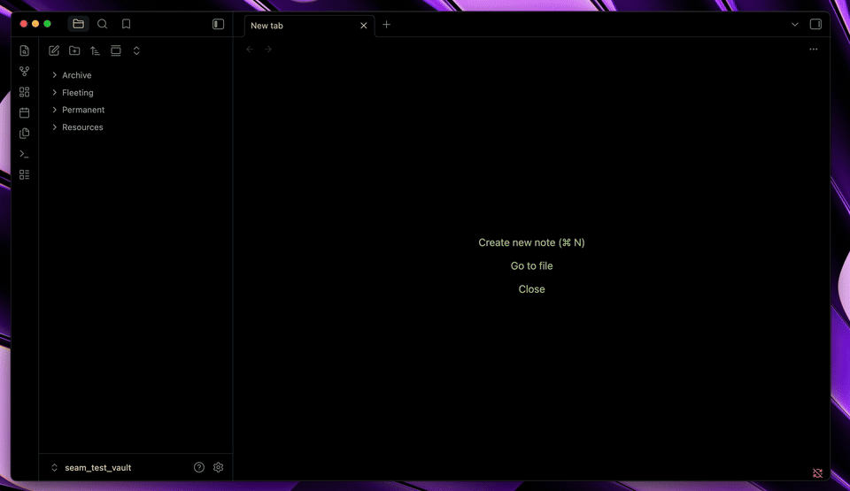

### Added

- **Quick Capture**: Create capture shortcuts with your preferred templates and folders.

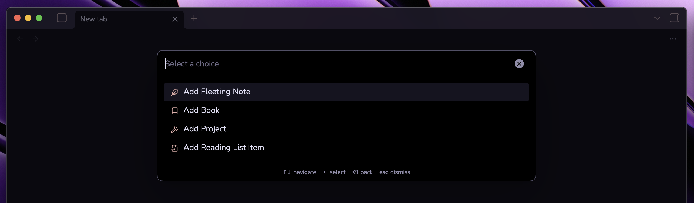

- **Special searches**: Find documents, images, tasks, code, and untagged notes. Search exact phrases with double quotes.

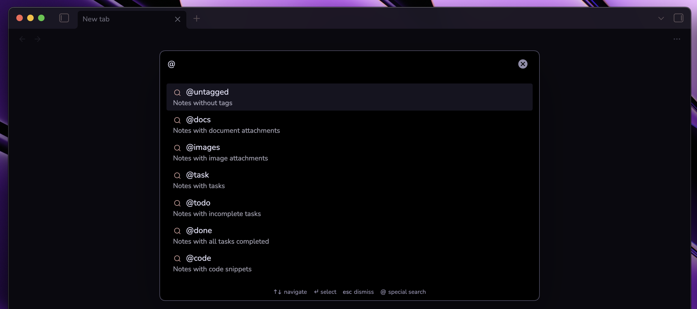

- **Exclude tags**: Use `!#tag` to leave matching notes out of your search.

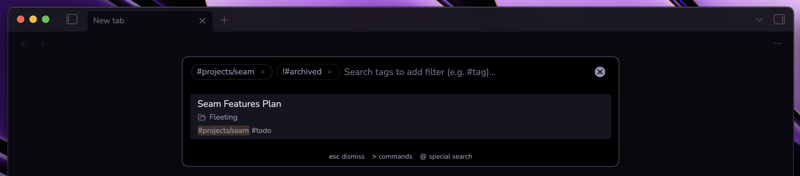

- **Recent Files**: Browse your ten most recently modified notes.

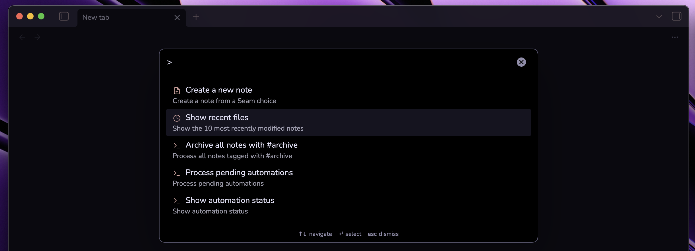

- **Release updates**: Choose when to receive update notices and read release notes in settings.

### Changed

- **Universal Palette**: Clearer search hints and command navigation.
- **Quick Capture settings**: Filter, reorder, duplicate, and customize your capture choices.

## [1.0.4] - 2026-09-15

### Changed

- Clearer English and Brazilian Portuguese guides for getting started and using Seam.

## [1.0.3] - 2026-09-14

### Added

- **Automation timing**: Organize notes when switching notes or after a short delay.
- **Shortcut settings**: See your Palette shortcut and customize it through Obsidian's Hotkeys settings.
- **Visual walkthrough**: Preview Seam's organization and search features in the documentation.
- **Project support**: New sponsorship options.

### Changed

- Seam is now licensed under the GNU General Public License v3.0.

## [1.0.2] - 2026-09-13

### Changed

- Choose your Palette shortcut in Obsidian's Hotkeys settings; no shortcut is assigned by default.
- Improved native settings appearance and support for pop-out windows.

## [1.0.1] - 2026-09-13

### Changed

- Updated Seam's plugin listing information.

## [1.0.0] - 2026-09-13
<!-- iterations: iteration_00..iteration_05 -->

Initial public release of **Seam**.

### Added

- **Automatic organization**: Move notes with `#permanent` and `#archive` on desktop and mobile.
- **Move cleanup**: Remove temporary tags and properties as notes are organized.
- **Universal Palette**: Search titles, note content, and tags from one place.
- **Fleeting notes**: Create notes instantly with an optional template.
- **Palette actions**: Open results in new tabs and run Seam commands.
- **Organization commands**: Archive notes, move them to Permanent, and process pending automations.
- **Personalization**: Customize folders, shortcuts, and search icons.
- **Languages**: English and Brazilian Portuguese.
