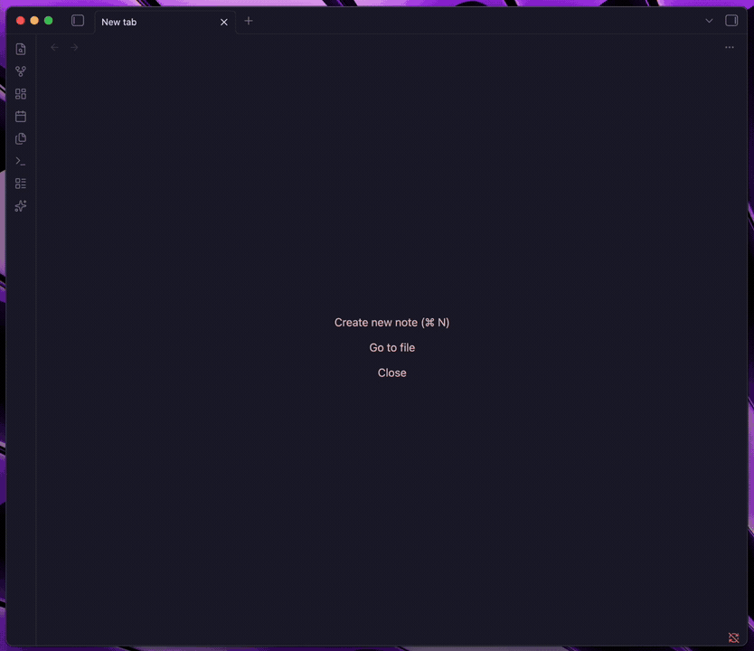
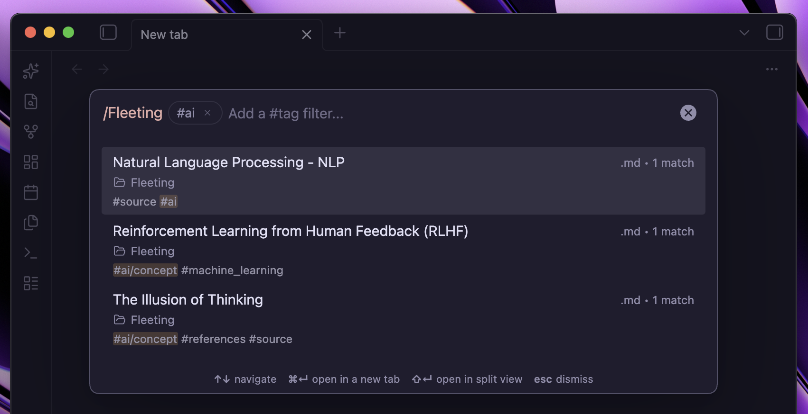
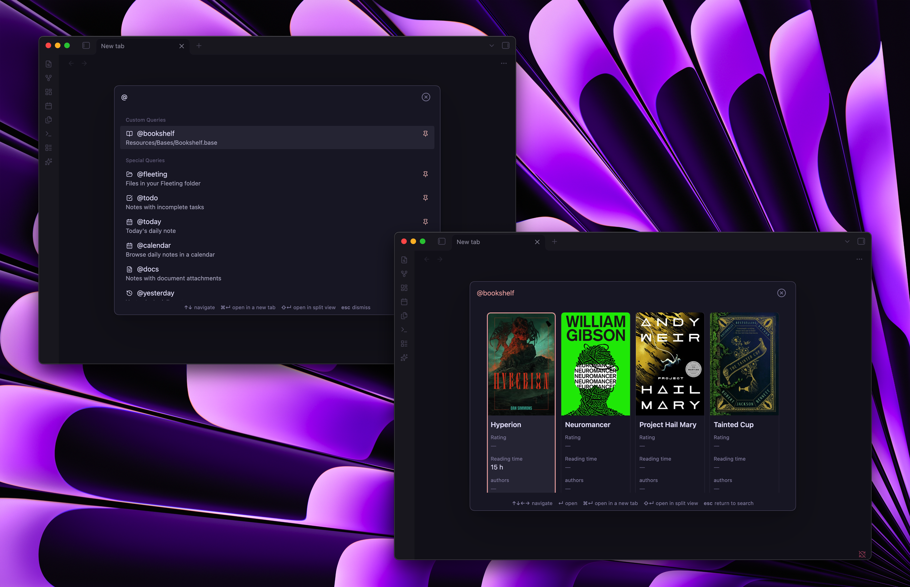
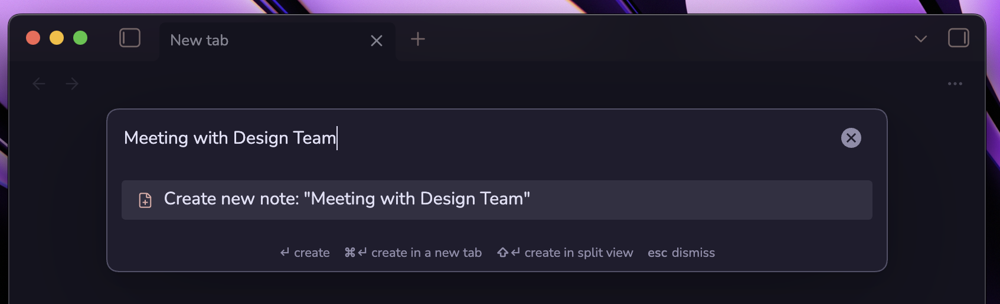
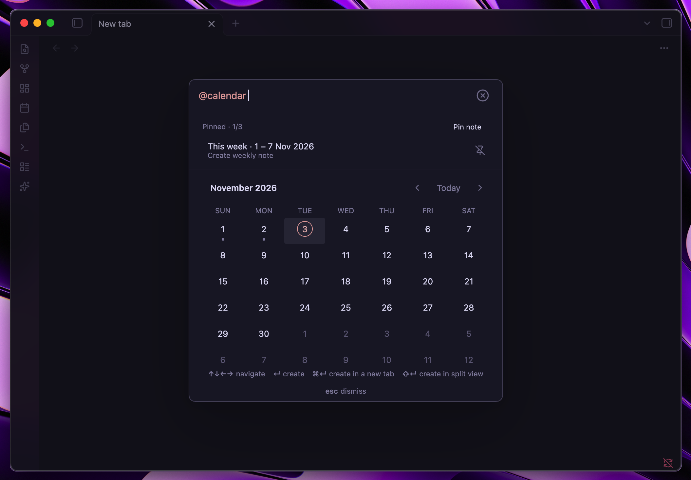
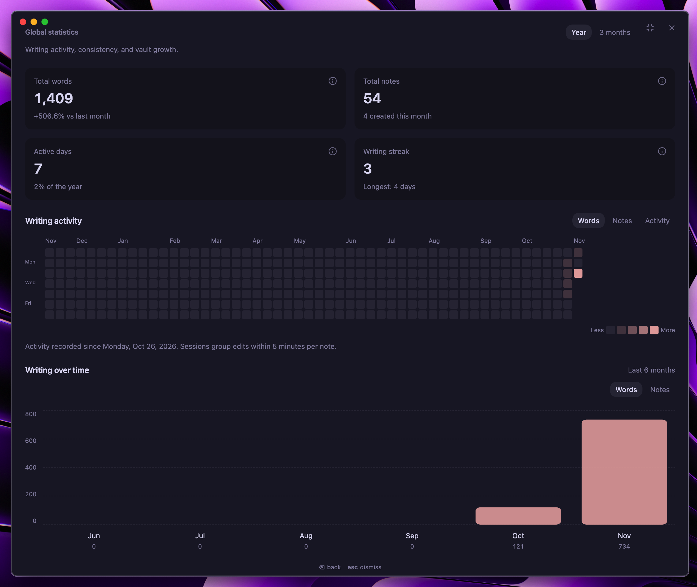
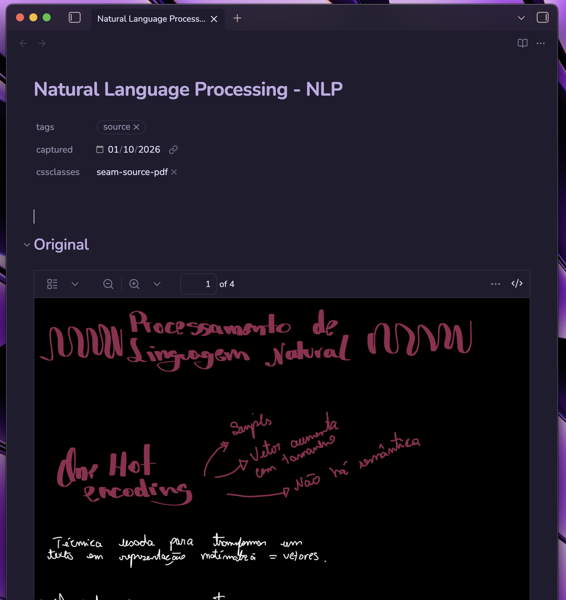

# Seam — Frictionless Note Organization for Obsidian

> **English** · [Português](README.pt-br.md)

> Capture thoughts, tag naturally, and let Seam organize your vault quietly in the background.

Seam is a lightweight Obsidian plugin for capturing, finding, and organizing notes. Inspired by [Zettelkasten](https://zettelkasten.de/introduction/), Apple Notes, and Bear, it brings a simple `Fleeting`, `Permanent`, and `Archive` workflow to your vault—so you can spend less time managing files and more time writing.

> [!NOTE]
> **100% private.** Seam does not collect or send us your personal information, note contents, or usage data. Your writing statistics stay on your devices and can be synced through your chosen service.

## Why Seam?

| Traditional workflow                                         | With Seam                                                                    |
| :----------------------------------------------------------- | :--------------------------------------------------------------------------- |
| ❌ Break your flow to create a note                          | ✅ Capture an idea from the Universal Palette, with your preferred template. |
| ❌ Move notes between folders by hand                        | ✅ Add `#permanent` and let Seam file a note for you.                        |
| ❌ Leave finished work mixed with active notes               | ✅ Add `#archive` to move it out of the way.                                 |
| ❌ Switch between search tools                               | ✅ Search notes, files, tags, saved queries, and commands in one place.      |
| ❌ Juggle separate views to revisit notes and track progress | ✅ Browse your notes in a calendar and explore your writing statistics.      |
| ❌ Depend on desktop-only workflows                          | ✅ Use the same workflow on desktop and mobile.                              |

## Find and create with the Universal Palette

The Universal Palette brings search and action together. Find notes by title, content, tag, or folder; preview matches; and create a note when you need one. Type `>` to run Seam commands, or open the Palette directly in command mode.

Combine filters like `/Fleeting #project !#archived`, save your favorite searches, and pin notes, commands, or queries for quick access. You can also browse an Obsidian Base as a table or cards without leaving the Palette.

## Make space for writing

### Capture and organize

Create Fleeting notes from the Palette or use Quick Capture choices with your own folders and templates. When a note is ready to keep, add `#permanent`; when you're done with it, add `#archive`. Seam moves the note and can clean up tags and properties you no longer need.

### Keep your days connected

Open `@calendar` to browse Daily Notes and create missing ones from your template. Open or create weekly and yearly notes, pin important notes above the calendar, and move unfinished tasks between Daily Notes.

### See your progress

Explore **Global Statistics** for your current note and word totals, writing activity, streaks, and monthly trends. Select a day to revisit its notes. For a closer look, open a note's statistics, task completion, or outline in the Palette.

Writing history starts when Seam begins recording it; your existing notes are still included in vault totals. To share activity with Obsidian Sync, enable **Sync all other types** on each device.

### Bring your sources along

Turn documents and images into linked Source notes, then find them with `@sources`. Seam can create notes automatically for files in your chosen source folder, and you can read PDFs with continuous pages.

## Get started

Seam requires Obsidian **1.13.0** or later.

1. In Obsidian, open **Settings → Community plugins**, turn off Restricted mode if needed, and browse for **Seam**.
2. Install and enable the plugin.
3. In Seam settings, choose your folders and templates—or preview **Initialize Seam** for a recommended setup. Setup is optional and doesn't move or edit existing notes.
4. Open the **Universal Palette** from Obsidian's command palette or assign it a shortcut.

Initialize Seam can also set up a Bookshelf Base and the `@bookshelf` and `@reading` searches. Review the proposed changes before applying them.

<!-- Screenshot or GIF: Initialize Seam and Bookshelf -->

For manual installation, download `main.js`, `manifest.json`, and `styles.css` from [Releases](https://github.com/WillACosta/obsidian-seam/releases), place them in `<vault>/.obsidian/plugins/obsidian-seam/`, then reload Obsidian and enable Seam.

## Languages

Seam follows Obsidian's language setting and supports English and Brazilian Portuguese. Other languages fall back to English. Translation contributions are welcome.

## Support the project

Seam is free and open source. If it saves you time, consider supporting its development:

**Pix** 

## Development and license

See [README.dev.md](README.dev.md) for development and release instructions. Seam is licensed under the [GNU General Public License v3.0](LICENSE).

Seam was built with the help of AI agents, guided by plain-text specifications written by me.

Crafted with care by **William A. Costa** ([@WillACosta](https://github.com/WillACosta)).
