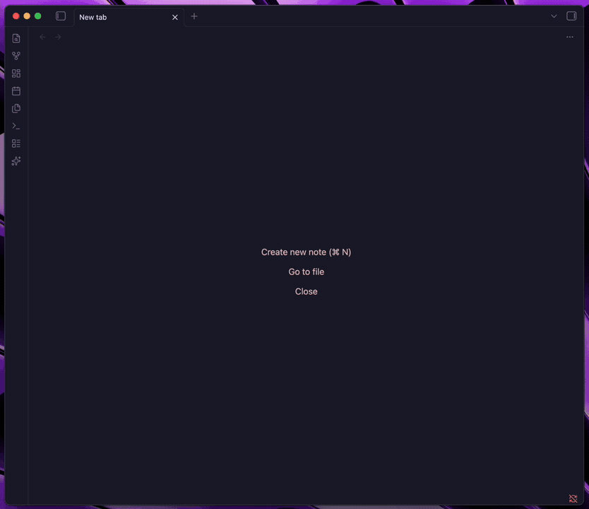
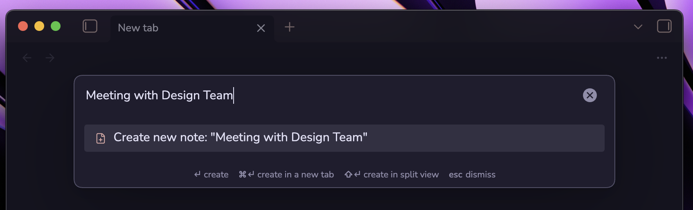
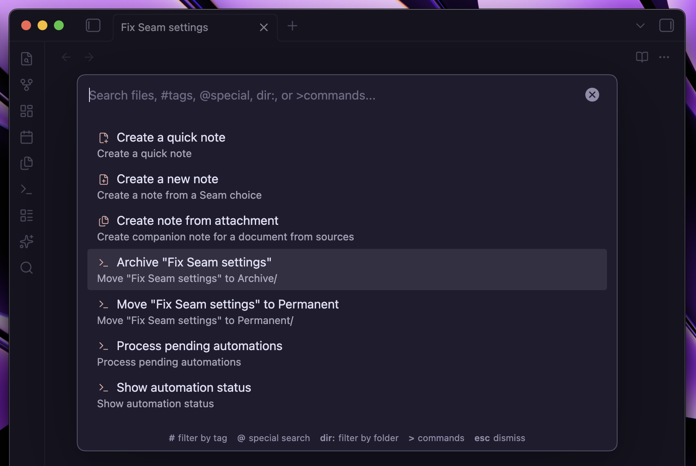
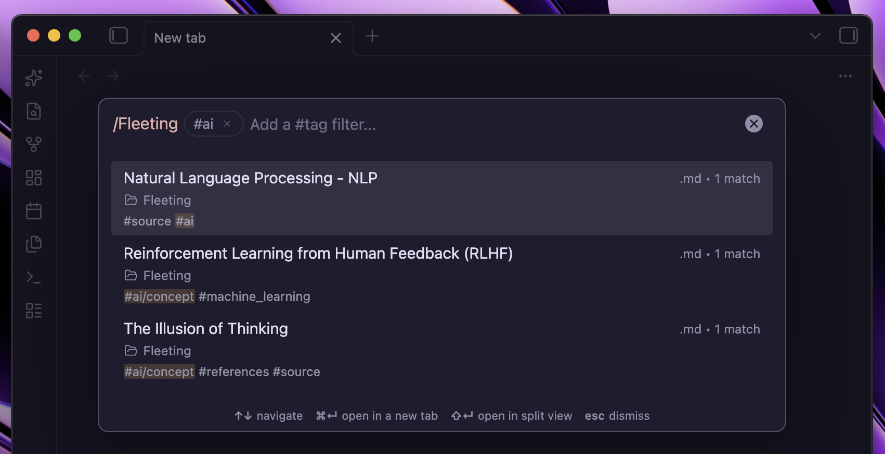
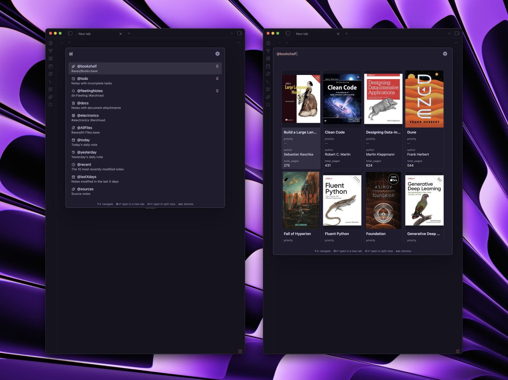
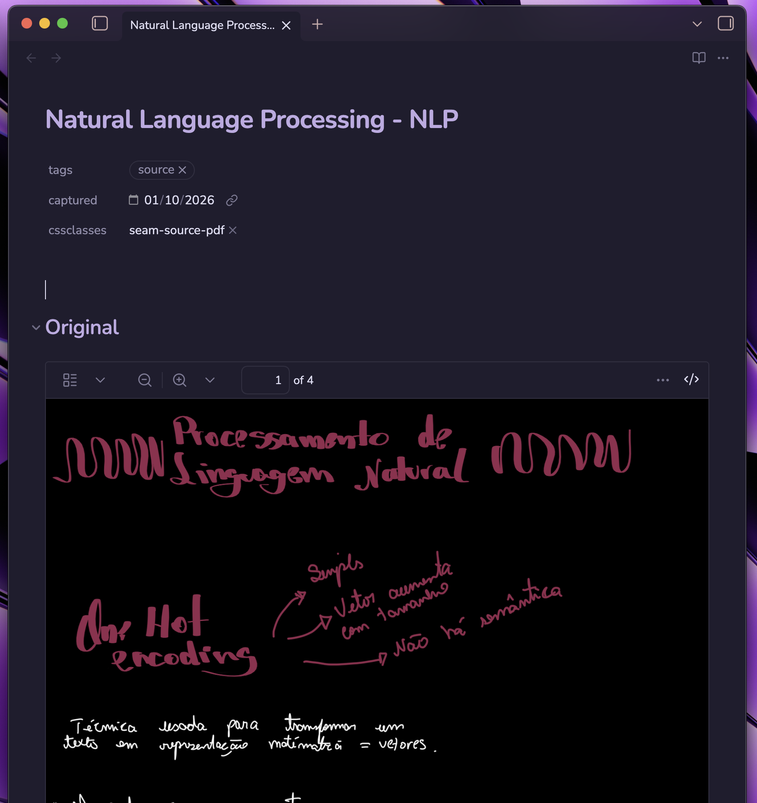
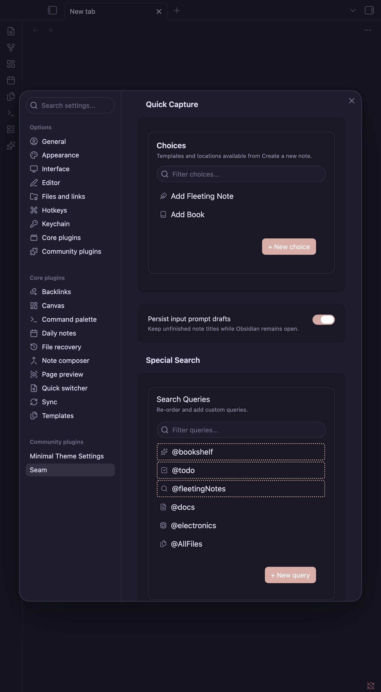

# Seam — Frictionless Note Organization for Obsidian

> **English** · [Português](README.pt-br.md)

> Capture thoughts, tag naturally, and let Seam organize your vault quietly in the background.

Seam is a lightweight Obsidian plugin that organizes notes through tags. Inspired by the [Zettelkasten](https://zettelkasten.de/introduction/) method and apps like Apple Notes and Bear, it uses a simple workflow built around `Fleeting`, `Permanent`, and `Archive`. Add `#permanent` or `#archive` to move a note, and use the Universal Palette to search your vault. Spend less time managing files and more time writing.



## Why Seam?

Seam keeps organization simple and stays out of your way:

| Traditional Workflow | With Seam |
|:---|:---|
| ❌ Move files between folders by hand | ✅ Add `#permanent` to file a note automatically |
| ❌ Leave completed notes mixed with active work | ✅ Add `#archive` to move them out of the way |
| ❌ Switch between different search tools | ✅ Search notes, content, tags, and commands in one palette |
| ❌ Use separate tools for search, quick capture, and source notes | ✅ Explore Special Search, create notes with Quick Capture, and keep Source notes linked from the same workflow |
| ❌ Maintain a deep folder hierarchy | ✅ Use a simple workflow guided by tags |
| ❌ Depend on desktop-only features | ✅ Use Seam on desktop and mobile |

## How Seam Fits into Your Workflow

### 1. Capture Without Friction (Fleeting Notes)

Open the **Universal Palette** from the command palette or with your chosen shortcut, then type a note title. If the note does not exist, press `Enter` to create it in `Fleeting/`. You can also use a template for your preferred properties and headings.

```
Universal Palette → "Meeting with Design Team" → [Create new note]
```


### 2. File Permanent Notes (`#permanent`)

When a note is ready to keep, add `#permanent` in the note body or properties.

Seam will:

1. Move the note to your `Permanent/` folder.
2. Remove the `#permanent` action tag.
3. Remove any additional tags or properties you chose in settings.

### 3. Archive Completed Work (`#archive`)

When a project, task, or meeting note is complete, add `#archive`.

1. The note moves to your `Archive/` folder.
2. Seam removes the `#archive` action tag.
3. Seam can add `#archived` so the note remains easy to find.



### 4. Search and Filter with Live Tag Chips

Open the **Universal Palette**:

- **Search notes and content**: Find matches in titles, paths, and note text.
- **Filter by tag**: Type `#` to browse tags, then press `Enter` to add one.
- **Combine filters**: Add multiple tag chips and remove them with `Backspace` or `×`.
- **Open in a new tab**: Press `Cmd + Enter` on macOS or `Ctrl + Enter` on Windows and Linux.



## Key Features

### Hands-Off Tag Routing

Seam reads action tags from the note body or properties. It creates destination folders when needed, avoids overwriting files, and removes action tags only after a successful move. If a note has both `#permanent` and `#archive`, Seam leaves it in place.

### Universal Palette

Search and act from one place:

- Find notes by title, path, tag, or content.
- Preview matching text before opening a note.
- Create a fleeting note when no result matches.
- Type `>` to run Seam commands.

### Custom Search

Keep your favorite searches one step away. Create shortcuts for projects, reading lists, or any collection of notes, and pin them in the Universal Palette. Choose how each query finds notes:

- **Seam search system**: Combine tags, directory filters, and text search in a reusable query.
- **Bases**: Use a Base and its views to explore results as tables or cards in the Universal Palette.



### Automatic Cleanup on Move

Choose which temporary tags and note properties Seam removes after a successful move. For example, you can clear `#todo`, `#review`, or a `status` property.

### Fleeting Note Templates

Choose a template note, such as `Templates/Fleeting Note`. New notes created from the palette will start with its content and properties.

### Source Notes

Bring handwritten notes, documents, and images into your workflow. Export them to `Sources/`, and Seam creates a note linked to the original.

Find your sources with `@sources` in the Universal Palette and read PDFs with continuous pages.



### First-Class Mobile Support

Seam uses Obsidian's public APIs and no desktop-only code. It works on desktop, iPhone, iPad, and Android.

## Settings



Customize Seam under **Settings → Community Plugins → Seam**.

## Installation

### From Obsidian Community Plugins

1. Open **Settings → Community plugins** in Obsidian.
2. Turn off **Restricted mode** if needed.
3. Click **Browse** and search for **Seam**.
4. Click **Install**, then **Enable**.

### Manual Installation

1. Download the latest release (`main.js`, `manifest.json`, `styles.css`) from the [Releases](https://github.com/WillACosta/obsidian-seam/releases) page.
2. Create a folder named `obsidian-seam` inside your vault's plugin directory: `<vault>/.obsidian/plugins/obsidian-seam/`.
3. Copy the downloaded files into that folder.
4. Reload Obsidian and enable **Seam** under **Settings → Community plugins**.

## Seam Filtering Syntax

Use these tokens in the Universal Palette to narrow a search or switch modes:

| Token | What it does | Example |
|:---|:---|:---|
| `#tag` | Filter notes by tag. | `#reading` |
| `!#tag` or `-#tag` | Exclude notes with a tag. | `!#archived` |
| `/` | Filter notes by directory. Put paths with spaces in quotes. | `/Fleeting` · `/"Project Archive"` |
| `@` | Run a built-in or custom Special Search. | `@today` · `@sources` · `@books` |
| `OR` or `||` | Match either side of a search. | `#reading OR #research` |
| `>` | Browse and run Seam commands. | `>archive` |

Pin up to **five special queries**, shared between built-in and custom queries, in Seam settings. Pinned queries appear first in the `@` listing. Press **Backspace** immediately after an active query to remove it in one step, including its trailing space.

Find files in your configured folders with `@fleeting` and `@permanent`, or browse the ten most recently opened files with `@recentlyOpened`. Combine these with other Seam filters.

Daily Notes appear with readable dates and a calendar subtitle. If `@today` or `@yesterday` has no Daily Note, select the offered action to create and open it from your configured template. While today's Daily Note is open, use **Move todo items to tomorrow's daily note** or **Pull todo items from yesterday's daily note** in Seam's commands. Each task command appears only when its source note has unfinished work. Seam follows the core Daily Notes folder, date format, and template. It moves unchecked (`[ ]`) and partially complete (`[/]`) tasks with their parent context, leaving completed tasks behind. If a partially complete parent remains with only completed children, its source checkbox becomes completed.

### Daily Notes calendar

Enter `@calendar` in the Universal Palette to browse Daily Notes. Dots mark dates with notes; click one to open it. Clicking an empty date selects it and offers **Create daily note**, using your Daily Notes folder, date format, and template. The calendar starts at the open Daily Note or today. `@today`, `@yesterday`, and `@calendar` stay together in the special-query list.

Use Up/Down from the input to enter the calendar, then arrow keys to move by day/week. Page Up/Down changes months; add Shift to change years. Click the month/year heading, or reach it with Tab and press Enter, to choose a year and then a month. Enter opens or creates the selected day's note. Press `Esc` once to return to the input, then again to dismiss the Palette. Toolbar controls also support Tab and Enter/Space.

The selected day also offers **Open weekly note** or **Create weekly note**, with the week’s date range. In **Seam settings → Calendar and periodic notes**, use enabled Periodic Notes settings automatically or configure a weekly folder, filename format, and template in Seam. Use `gggg-[W]ww` for locale weeks or `GGGG-[W]WW` for Monday-based ISO weeks; the calendar follows the same week boundaries. Templates support `{{date}}`, `{{title}}`, `{{time}}`, and weekday tokens such as `{{monday:YYYY-MM-DD}}`.

Use **Pin note** in the calendar or **Pin current note to calendar** in Obsidian/Seam commands to keep up to three notes above the calendar. Pins stay visible while browsing dates and pickers, follow note moves/renames, and are removed when a note is deleted. Use the unpin button or **Unpin current note from calendar** to remove one.

**Keep this week pinned** uses one of those slots for the real current week. It follows each new week independently of the date you browse; if its note is missing, creation is offered explicitly. Other pins, such as annual goals, remain fixed. Tab reaches pins and weekly actions; Enter/Space activates them, and the footer follows the focused action.

### Current week and year notes

Use `@thisWeek` for the current week's note and `@thisYear` for the current calendar year's note. Like `@today`, they offer an existing note to open or an explicit creation suggestion if missing. Enter uses the current tab; Mod+Enter opens a new tab; Shift+Enter or Mod+Shift+Enter opens a split. You can filter existing results with tags, text, or folders without creating duplicates.

Weekly queries reuse the calendar's weekly settings. For yearly notes, configure the folder, format, and template in **Seam settings → Calendar and periodic notes**. Defaults are `Yearly/YYYY.md` and no template; enabled Periodic Notes yearly settings are used when the shared Periodic Notes option is on. Yearly templates use January 1 for `{{date}}`, the filename for `{{title}}`, and support `{{time}}`. Annual pins remain fixed until you unpin or delete them.

### Delete current note

With a Markdown note open, choose **Delete current note** from Obsidian's commands or Seam's `>` commands. Seam uses Obsidian's delete confirmation setting and configured destination: system trash, the vault `.trash` folder, or permanent deletion. Cancelling the native confirmation leaves the note intact.

### Note outline

With a Markdown note open, choose **Show note outline** from Obsidian's commands or Seam's `>` commands. The Universal Palette lists every heading in document order, with nested headings indented. Use Up/Down to navigate and Enter or a click to jump to a heading in the current pane. Type to filter headings, press `Backspace` with an empty input to return to Palette search, or press `Esc` to dismiss.

### Note statistics

With a Markdown note open, choose **Show note statistics** from Obsidian's commands or Seam's `>` commands. The Universal Palette displays words, characters, paragraphs, estimated reading time, and localized creation/modification dates. Counts include current unsaved editor text; characters include whitespace and Markdown, paragraphs are separated by blank lines, and reading time uses 200 words per minute. Press Backspace to return to Palette search, or press `Esc` or use the close button to dismiss.

### Global statistics

Choose **Show global statistics** from Obsidian commands or the Palette’s `>` commands. View current Markdown note/word totals, recorded active days, and the current writing streak. Explore 52 weeks or three months of writing activity by words written, distinct notes edited, or writing sessions; use the chips to change metrics and periods, and select a day to open its notes. **Writing over time** shows six vertical monthly bars with a shared linear scale for words written or notes created. Arrow keys navigate the calendar, Enter selects a day, and Backspace returns to the Palette.

Writing history starts when this feature is enabled; existing notes count toward vault totals without generating historical activity. Words written counts new words, including replacements, without counting each typed character or replaying undo/redo. A writing session groups direct editor edits to the same note within five minutes; the streak continues through yesterday while today is still in progress. Dates use the local calendar date when an edit happens and stay attached to that date after timezone changes.

Current totals include imports, sync, and automated changes, but these do not count as writing contributions. Notes created measures Markdown creation events observed after tracking starts, including imports, separately from writing activity. History stays local in Seam’s plugin folder (`statistics.json`), with a local recovery journal for interrupted saves. No note text is stored in the activity log.

## Languages

Seam follows Obsidian's language setting. It currently supports:

- **English (US)**
- **Portuguese (BR)**

Other languages use English by defaultCombined search.

### Contributing Translations

Want to use Seam in another language? Contributions are welcome:

1. Create a new locale file in `src/i18n/locales/<locale-code>.ts` (e.g., `es.ts`, `fr.ts`, `de.ts`) implementing the `Translations` type.
2. Register the new locale in `src/i18n/index.ts`.
3. Open a Pull Request on [GitHub](https://github.com/WillACosta/obsidian-seam).

## Support the Project

Seam is free and open source. If it saves you time, consider supporting its development:

[](https://ko-fi.com/acostawill)

**Pix**<br>


## Development

For developer instructions, Spec-Driven Development (SDD) guidelines, and release procedures, see [README.dev.md](README.dev.md).

## License

This project is licensed under the [GNU General Public License v3.0](LICENSE).

## Built with

Seam was built with the help of AI agents. Each iteration was guided and documented with plain-text specifications written by me.

Crafted with care by **William A. Costa** ([@WillACosta](https://github.com/WillACosta)).
