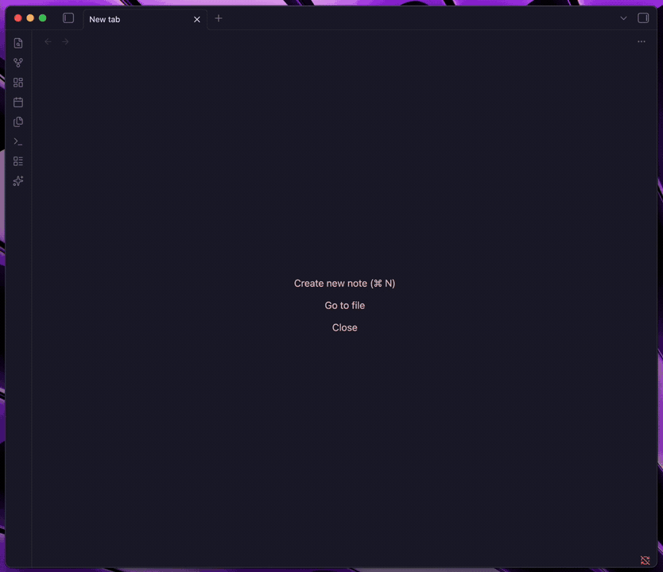
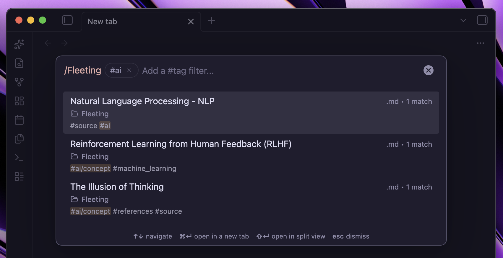
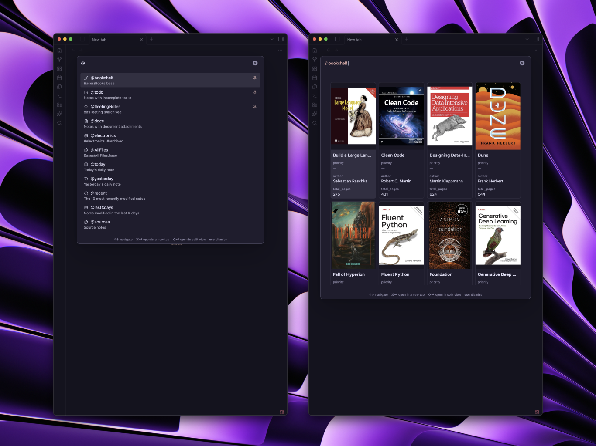
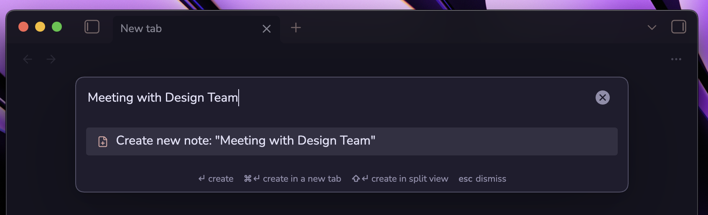
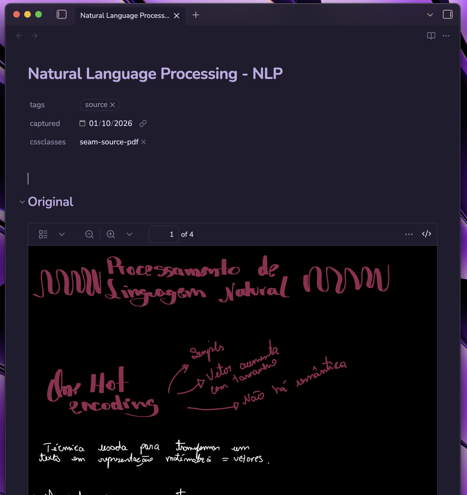

# Seam — Organização de Notas sem Fricção para o Obsidian

> [English](README.md) · **Português**

> Capture ideias, use tags naturalmente e deixe o Seam organizar suas notas em segundo plano.

O Seam é um plugin leve para Obsidian que ajuda você a capturar, encontrar e organizar notas. Inspirado no [Zettelkasten](https://zettelkasten.de/introduction/), no Apple Notes e no Bear, ele traz um fluxo simples entre `Fleeting`, `Permanent` e `Archive` para o seu cofre — para você passar menos tempo gerenciando arquivos e mais tempo escrevendo.

> [!NOTE]
> **100% privado.** O Seam não coleta nem nos envia suas informações pessoais, o conteúdo das suas notas ou dados de uso. Suas estatísticas de escrita ficam nos seus dispositivos e podem ser sincronizadas pelo serviço que você escolher.

## Por que o Seam?

| Fluxo tradicional | Com o Seam |
| :--- | :--- |
| ❌ Interromper o que está fazendo para criar uma nota | ✅ Capture uma ideia pela Paleta Universal, com o modelo que preferir. |
| ❌ Mover notas manualmente entre pastas | ✅ Adicione `#permanent` e deixe o Seam organizar a nota para você. |
| ❌ Misturar trabalhos concluídos com notas em andamento | ✅ Adicione `#archive` para arquivá-los. |
| ❌ Alternar entre ferramentas de busca | ✅ Busque notas, arquivos, tags, consultas salvas e comandos em um só lugar. |
| ❌ Usar visualizações separadas para rever notas e acompanhar o progresso | ✅ Navegue pelas notas em um calendário e explore suas estatísticas de escrita. |
| ❌ Depender de fluxos exclusivos para desktop | ✅ Use o mesmo fluxo no computador e em dispositivos móveis. |

## Encontre e crie com a Paleta Universal

A Paleta Universal reúne busca e ações em um só lugar. Encontre notas por título, conteúdo, tag ou pasta; veja os trechos encontrados; e crie uma nota quando precisar. Digite `>` para executar comandos do Seam ou abra a Paleta diretamente no modo de comandos.

Combine filtros como `/Fleeting #projeto !#archived`, salve suas buscas favoritas e fixe notas, comandos ou consultas para acessá-los rapidamente. Você também pode explorar uma Base do Obsidian em tabela ou cartões sem sair da Paleta.

## Mais espaço para escrever

### Capture e organize

Crie notas efêmeras pela Paleta ou use opções do Quick Capture com suas próprias pastas e modelos. Quando quiser guardar uma nota, adicione `#permanent`; quando terminar, adicione `#archive`. O Seam move a nota e pode limpar tags e propriedades que você não precisa mais.

### Conecte seus dias

Abra `@calendar` para navegar pelas Notas Diárias e criar as que faltam com seu modelo. Abra ou crie notas semanais e anuais, fixe notas importantes acima do calendário e mova tarefas pendentes entre Notas Diárias.

<!-- Captura de tela ou GIF: Calendário e notas periódicas -->

### Acompanhe seu progresso

Explore as **Estatísticas globais** para ver o total atual de notas e palavras, sua atividade de escrita, sequências e tendências mensais. Selecione um dia para rever suas notas. Para olhar mais de perto, abra as estatísticas, a conclusão de tarefas ou a estrutura de uma nota na Paleta.

O histórico de escrita começa quando o Seam passa a registrá-lo; suas notas existentes continuam incluídas nos totais do cofre. Para compartilhar a atividade pelo Obsidian Sync, ative **Sincronizar todos os outros tipos** em cada dispositivo.

<!-- Captura de tela ou GIF: Estatísticas globais -->

### Mantenha suas fontes por perto

Transforme documentos e imagens em Notas de Fontes vinculadas ao original e encontre-as com `@sources`. O Seam pode criá-las automaticamente para arquivos na pasta de fontes escolhida, e você pode ler PDFs em páginas contínuas.

## Comece a usar

O Seam requer o Obsidian **1.13.0** ou posterior.

1. No Obsidian, abra **Configurações → Plugins da comunidade**, desative o Modo restrito se necessário e procure por **Seam**.
2. Instale e ative o plugin.
3. Nas configurações do Seam, escolha suas pastas e modelos — ou abra **Inicializar o Seam** para visualizar uma configuração recomendada. A configuração é opcional e não move nem edita notas existentes.
4. Abra a **Paleta Universal** pela paleta de comandos do Obsidian ou atribua um atalho a ela.

A inicialização também pode configurar uma Base Bookshelf e as buscas `@bookshelf` e `@reading`. Revise as alterações propostas antes de aplicá-las.

<!-- Captura de tela ou GIF: Inicializar Seam e Bookshelf -->

Para instalar manualmente, baixe `main.js`, `manifest.json` e `styles.css` na página de [Releases](https://github.com/WillACosta/obsidian-seam/releases), coloque-os em `<cofre>/.obsidian/plugins/obsidian-seam/`, recarregue o Obsidian e ative o Seam.

## Idiomas

O Seam segue o idioma configurado no Obsidian e oferece suporte a inglês e português brasileiro. Outros idiomas usam inglês por padrão. Contribuições de tradução são bem-vindas.

## Apoie o projeto

O Seam é gratuito e de código aberto. Se ele economiza seu tempo, considere apoiar seu desenvolvimento:

**Pix** 

## Desenvolvimento e licença

Consulte o [README.dev.md](README.dev.md) para instruções de desenvolvimento e release. O Seam está sob a licença [GNU General Public License v3.0](LICENSE).

O Seam foi desenvolvido com o auxílio de agentes de IA, guiados por especificações em texto escritas por mim.

Desenvolvido com cuidado por **William A. Costa** ([@WillACosta](https://github.com/WillACosta)).
